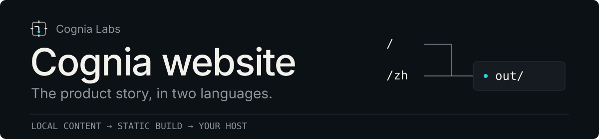
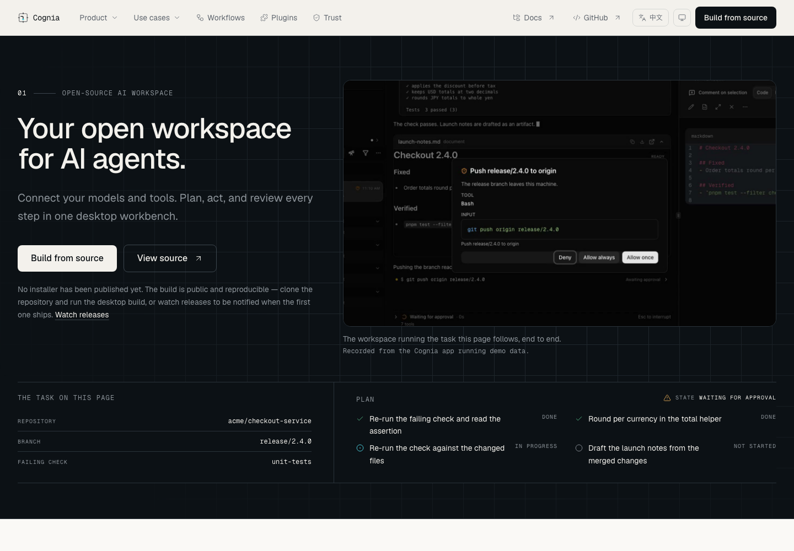

<p align="center">
  
</p>

<p align="center">
  <a href="https://github.com/cognia-labs/cognia-website/actions/workflows/ci.yml"></a>
  <a href="LICENSE"></a>
</p>

<p align="center">
  <strong>English</strong> · <a href="README.zh-CN.md">简体中文</a><br>
  <a href="#run-locally">Run locally</a> · <a href="docs/deployment.md">Deploy</a> · <a href="CONTRIBUTING.md">Contribute</a> · <a href="https://github.com/cognia-labs/cognia-website/issues">Report an issue</a>
</p>

**Cognia website** is the English and Chinese product site maintained by [Cognia Labs](https://github.com/cognia-labs). Develop, test and ship it from a single clone. Next.js 16, React 19, TypeScript and Tailwind CSS 4 build to static files in `out/`.



_Captured from the production static export. The embedded application footage uses demo data._

## One repository, one static artifact

- **Two languages:** English at `/`, Chinese at `/zh`, with typed copy and shared page structure.
- **Independent development:** committed fonts, media and product snapshots support ordinary development and builds without a product checkout or GitHub API requests.
- **Portable deployment:** publish `out/` to a static host, use Cloudflare Pages, or build the included Docker image.

This repository owns the marketing website. The application, services, SDKs and documentation remain in [cognia-next](https://github.com/MaxQian888/cognia-next). Original Git history and contributor attribution are retained in [NOTICE](NOTICE).

## Run locally

Use **Node 26** and **pnpm 11.18.0**, pinned in `package.json`. If your Node installation includes Corepack, run `corepack enable && corepack install`; otherwise install that pnpm version directly.

```sh
git clone https://github.com/cognia-labs/cognia-website.git
cd cognia-website
pnpm install --frozen-lockfile
pnpm dev
```

Open [localhost:3002](http://localhost:3002), or [localhost:3002/zh](http://localhost:3002/zh). No tokens or deployment credentials are needed.

To preview the deployment artifact:

```sh
pnpm build
pnpm start
```

`start` and `preview` serve `out/` on port 3002, including clean URLs, `/en` redirects, 404 responses and video range requests. Use `PORT=8080 pnpm start` for another port. Rebuild after source or public configuration changes; `next start` cannot serve this static export.

## Check a change

| Command             | What it checks                                             |
| ------------------- | ---------------------------------------------------------- |
| `pnpm check`        | Lint, types, script tests, unit tests and production build |
| `pnpm format:check` | Repository formatting                                      |
| `pnpm test:e2e`     | Desktop and mobile browser flows against the static export |

Install the browser once with `pnpm exec playwright install chromium`. CI also smoke-tests the Linux deployment container and the actual Pages runtime. Local checks do not collect coverage; the separate full-mode PR policy is documented in [CONTRIBUTING](CONTRIBUTING.md).

## Deploy the website

Public origins are embedded **at build time**. Copy `.env.example` to `.env.local` only when local overrides are needed.

| Variable                    | Local default                                 |
| --------------------------- | --------------------------------------------- |
| `NEXT_PUBLIC_WEB_SITE_URL`  | `http://localhost:3002`                       |
| `NEXT_PUBLIC_DOCS_SITE_URL` | `http://localhost:3001`                       |
| `CF_PAGES_URL`              | Unset; optional Pages preview-origin fallback |

For production, export your website and documentation **HTTPS origins** in the shell or CI, then run `pnpm deploy:check`. The validator reads shell values, not `.env.local`. Never place secrets in `NEXT_PUBLIC_*` variables.

The manual **Deploy website** workflow supports separate `staging` and `production` GitHub Environments. Staging publishes to the Pages `staging` branch; production requires source `main` and publishes to `main`. Use its dry-run to check missing configuration before uploading. Public domains and cloud credentials must be supplied separately.

**[Cloudflare Pages, Docker and static-host instructions →](docs/deployment.md)**

**[Feishu workflow notifications and secret-free previews →](docs/notifications.md)**

## Find your way around

| Path                             | Start here to…                                   |
| -------------------------------- | ------------------------------------------------ |
| `app/`                           | Change routes, metadata or global styles         |
| `components/`, `hooks/`, `lib/`  | Update UI and behavior with co-located tests     |
| `content/en.ts`, `content/zh.ts` | Edit both language versions                      |
| `content/generated/`             | Review pinned product facts and source contracts |
| `public/`, `video/`              | Maintain shipped assets or author product films  |
| `scripts/`, `e2e/`, `.github/`   | Work on tooling, acceptance checks or automation |

## Keep product claims traceable

The site reads versioned evidence, not an implicit live product checkout. `product-source.json` records the product revision, capture time, working-tree state and source hashes; `evidence.json` holds repository and release facts.

To intentionally refresh them, select a separate product clone and review the generated diff:

```sh
pnpm product:export --source-root /absolute/path/to/cognia-next
pnpm evidence:update
pnpm check
```

Only the explicit refresh uses the GitHub API; optional `GITHUB_TOKEN` / `GH_TOKEN` raises its rate limit. Failed requests retain previous network values and record errors. The refresh workflow creates a review branch, with no automatic deployment; `verify_only=true` validates and uploads evidence without creating a branch.

**[Snapshots, screenshot capture and film maintenance →](docs/maintenance.md)**

## Make a contribution

Start with the [contribution guide](CONTRIBUTING.md) and [design system](DESIGN.md). Use [website issues](https://github.com/cognia-labs/cognia-website/issues) for site bugs and [product issues](https://github.com/MaxQian888/cognia-next/issues) for application behavior.

[Code of Conduct](CODE_OF_CONDUCT.md) · [Security](SECURITY.md) · [Support](SUPPORT.md) · [AGPL license](LICENSE)
