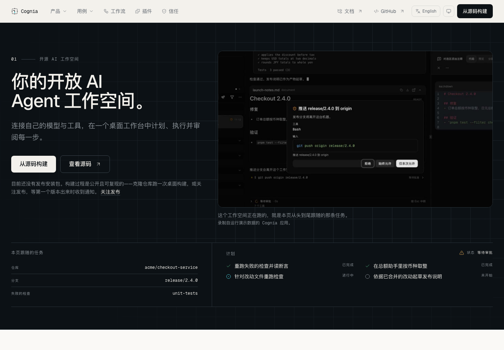

<p align="center">
  
</p>

<p align="center">
  <a href="https://github.com/cognia-labs/cognia-website/actions/workflows/ci.yml"></a>
  <a href="LICENSE"></a>
</p>

<p align="center">
  <a href="README.md">English</a> · <strong>简体中文</strong><br>
  <a href="#本地开发">本地开发</a> · <a href="docs/deployment.md">部署指南</a> · <a href="CONTRIBUTING.md">参与贡献</a> · <a href="https://github.com/cognia-labs/cognia-website/issues">反馈问题</a>
</p>

**Cognia website** 是由 [Cognia Labs](https://github.com/cognia-labs) 维护的 Cognia 中英文官网。一个克隆即可独立开发、测试和发布，使用 Next.js 16、React 19、TypeScript 和 Tailwind CSS 4，构建为 `out/` 中的静态文件。



_截图来自生产静态构建产物；页面中的应用录像使用演示数据。_

## 一个仓库，一份静态产物

- **中英双语：** 英文使用 `/`，中文使用 `/zh`，文案有类型约束，页面结构共用。
- **独立开发：** 字体、媒体和产品快照均随仓库维护，日常开发和构建不需要产品仓库或 GitHub API 请求。
- **灵活部署：** 将 `out/` 上传到静态托管，使用 Cloudflare Pages，或构建仓库中的 Docker 镜像。

本仓库负责官网。产品应用、服务、SDK 和文档仍在 [cognia-next](https://github.com/MaxQian888/cognia-next)。原有 Git 历史和贡献署名已经保留，详见 [NOTICE](NOTICE)。

## 本地开发

使用 `package.json` 指定的 **Node 26** 和 **pnpm 11.18.0**。若 Node 安装包含 Corepack，可运行 `corepack enable && corepack install`；否则直接安装该版本 pnpm。

```sh
git clone https://github.com/cognia-labs/cognia-website.git
cd cognia-website
pnpm install --frozen-lockfile
pnpm dev
```

访问 [localhost:3002](http://localhost:3002)，或中文页面 [localhost:3002/zh](http://localhost:3002/zh)。不需要 Token 或部署凭据。

预览实际部署产物：

```sh
pnpm build
pnpm start
```

`start` 和 `preview` 在端口 3002 提供 `out/`，支持干净路径、`/en` 重定向、404 和视频 Range 请求。可通过 `PORT=8080 pnpm start` 修改端口。修改源码或公开配置后需要重新构建；`next start` 无法提供这个静态导出应用。

## 验证修改

| 命令                | 检查内容                                 |
| ------------------- | ---------------------------------------- |
| `pnpm check`        | Lint、类型、脚本测试、单元测试和生产构建 |
| `pnpm format:check` | 仓库格式                                 |
| `pnpm test:e2e`     | 静态构建产物的桌面和移动端浏览器流程     |

首次运行浏览器测试前执行 `pnpm exec playwright install chromium`。CI 还验证 Linux 部署容器和实际 Pages 运行时。本地检查默认不收集覆盖率；完整模式 PR 的独立覆盖率策略见[贡献指南](CONTRIBUTING.md)。

## 部署官网

公开地址在**构建时**写入产物。只有需要本地覆盖配置时，才将 `.env.example` 复制为 `.env.local`。

| 变量                        | 本地默认值                            |
| --------------------------- | ------------------------------------- |
| `NEXT_PUBLIC_WEB_SITE_URL`  | `http://localhost:3002`               |
| `NEXT_PUBLIC_DOCS_SITE_URL` | `http://localhost:3001`               |
| `CF_PAGES_URL`              | 未设置；可作为 Pages 预览地址的回退值 |

生产部署前，在 Shell 或 CI 中导出官网和文档的 **HTTPS 地址**，再运行 `pnpm deploy:check`。校验器读取 Shell 环境，不读取 `.env.local`。不要将密钥放入 `NEXT_PUBLIC_*` 变量。

手动运行 **Deploy website** 工作流可选择独立的 `staging` 和 `production` GitHub Environment：staging 上传到 Pages 的 `staging` 分支，production 仅接受来源 `main` 并上传到 `main`。先用 dry-run 检查缺失配置，再执行上传。公开域名和云端凭据需要单独提供。

**[Cloudflare Pages、Docker 和其他静态托管的完整步骤 →](docs/deployment.md)**

**[飞书工作流通知与免密钥预览 →](docs/notifications.md)**

## 从哪里开始修改

| 路径                             | 用途                         |
| -------------------------------- | ---------------------------- |
| `app/`                           | 路由、元信息和全局样式       |
| `components/`, `hooks/`, `lib/`  | UI、交互行为及同目录测试     |
| `content/en.ts`, `content/zh.ts` | 两种语言的文案               |
| `content/generated/`             | 固定版本的产品事实和源码契约 |
| `public/`, `video/`              | 网站素材和产品影片制作       |
| `scripts/`, `e2e/`, `.github/`   | 工具、验收检查和自动化       |

## 让产品描述可以追溯

网站读取带版本的证据，不会隐式访问实时产品工作区。`product-source.json` 记录产品版本、捕获时间、工作区状态和源码哈希；`evidence.json` 保存仓库与发布信息。

主动更新时，指定独立的产品克隆，并审查生成文件的差异：

```sh
pnpm product:export --source-root /absolute/path/to/cognia-next
pnpm evidence:update
pnpm check
```

只有主动刷新才使用 GitHub API；可通过 `GITHUB_TOKEN` / `GH_TOKEN` 提高限额。请求失败时保留之前的网络数据并记录错误。刷新工作流只创建供审查的分支，不会自动部署；设置 `verify_only=true` 可仅验证并上传证据，不创建分支。

**[快照、截图和影片的维护方法 →](docs/maintenance.md)**

## 参与贡献

先阅读[贡献指南](CONTRIBUTING.md)和[设计系统](DESIGN.md)。官网问题提交到[本仓库 Issues](https://github.com/cognia-labs/cognia-website/issues)，应用行为问题提交到[产品 Issues](https://github.com/MaxQian888/cognia-next/issues)。

[行为准则](CODE_OF_CONDUCT.md) · [安全政策](SECURITY.md) · [支持](SUPPORT.md) · [AGPL 许可证](LICENSE)
